<div align="center">

# 🛡️ IAM Governance Lab: SailPoint IdentityIQ 8.1

### An end-to-end Identity Governance & Administration (IGA) project, built from scratch


**Joiner / Mover / Leaver · RBAC · Access Requests · Certifications · SoD Policies · Outlier Analysis**

</div>

---

## 📌 Overview

This project implements the core identity governance processes in **SailPoint IdentityIQ 8.1**. One HR file acts as the authoritative source. From it the lab creates identities, derives access, assigns roles automatically, runs the identity lifecycle, handles access requests, certifies access, detects segregation-of-duties violations and highlights access outliers.

> **Why it matters:** these are the processes behind security audits and compliance: least privilege, segregation of duties and periodic access review.

## 📊 At a glance

| 👥 Identities | 🔌 Applications | 🔑 Entitlements | 🎭 Roles | 🔄 Lifecycle events | 📜 Policies | ✅ Certification |
|:-:|:-:|:-:|:-:|:-:|:-:|:-:|
| **9** (+ admin) | **2** | **8** | **9** (6 IT + 3 Business) | **3** | **1** SoD | **8 / 8** items decided |

## 🏗️ Architecture and data flow

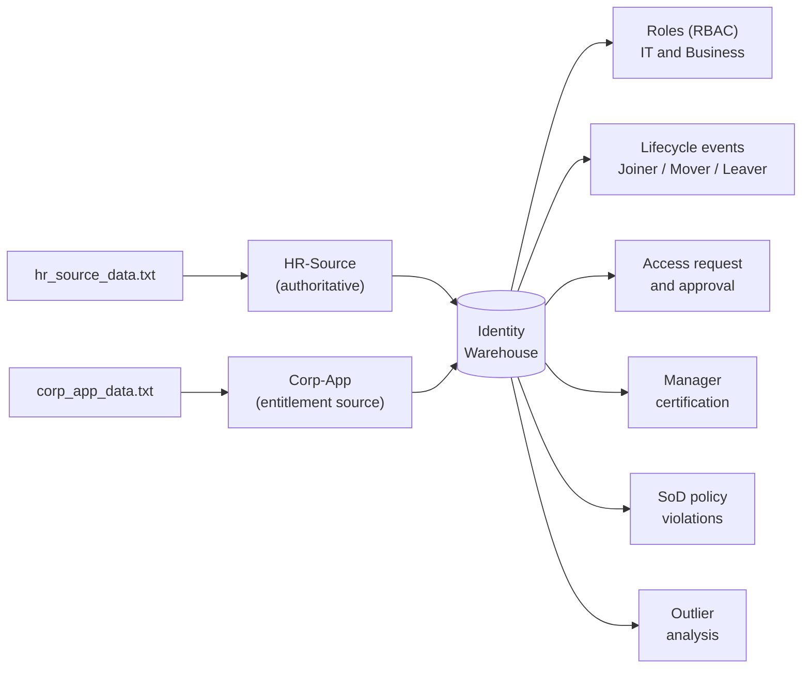

**Two applications:** `HR-Source` creates the identities (authoritative). `Corp-App` exposes `Department` and `JobTitle` as managed entitlements, which gives IdentityIQ access data to model, request, certify and check.

## ✨ What was built

| # | Capability | Implementation |
|---|---|---|
| 1 | **Authoritative source** | Delimited-file application `HR-Source`, correlation on `EmployeeID`, manager correlation on `Manager` |
| 2 | **Identity attributes** | `employeeId`, `department`, `jobTitle`, `hrStatus` mapped in Identity Mappings |
| 3 | **Entitlement catalog** | 8 entitlements promoted from `Corp-App`, with description, owner and requestable flag |
| 4 | **RBAC** | 6 IT roles and 3 Business roles with department-based assignment rules |
| 5 | **Lifecycle management** | Joiner (Create), Mover (`department` change) and Leaver (`hrStatus` = Leaver) events |
| 6 | **Access request** | Self-service request, owner approval and a provisioning step |
| 7 | **Certification** | Manager certification of 4 identities and 8 items, with one revoke |
| 8 | **Policy violation** | Role SoD policy `IT-vs-HR-SOD` with rule `IT-HR-Conflict` |
| 9 | **Outlier analysis** | Peer-group search and entitlement breakdown for the IT department |

## 🧰 Tech stack

SailPoint IdentityIQ **8.1** · Apache Tomcat · JDK · MySQL · Delimited-file connector · Lifecycle Manager · Certifications · Policies · Advanced Analytics

## 🎭 Role model

| Type | Role | Based on |
|---|---|---|
| IT | `IT-Dept-Access` | Department = IT |
| IT | `HR-dept-access` | Department = HR |
| IT | `Mgmt-Dept-Access` | Department = Management |
| IT | `HR-Speciality-Access` | JobTitle = HR Specialist |
| IT | `SysAdmin-Access` | JobTitle = SysAdmin |
| IT | `SecAnalyst-Access` | JobTitle = Security Analyst |
| Business | `BR-IT-Staff` | Assigned when department = IT, requires `IT-Dept-Access` |
| Business | `BR-HR-Staff` | Assigned when department = HR, requires `HR-dept-access` |
| Business | `BR-Management` | Assigned when department = Management, requires `Mgmt-Dept-Access` |

## 🔬 Test cases and results

| Test | Action | Result |
|---|---|---|
| **Joiner** | Added Grace Lee (HR) to the data file | Identity created and `BR-HR-Staff` assigned automatically |
| **Mover** | Changed David Miller's department from IT to HR | `BR-HR-Staff` assigned in place of `BR-IT-Staff` |
| **Leaver** | Set Alice Smith's status to `Leaver` | The *Lifecycle Event - Leaver* workflow raised request ID 1 to disable her account on `HR-Source` and `Corp-App`, plus a manual-action work item |
| **Access request** | Bob Jones requested the *Security Analyst* entitlement on `Corp-App` | Request ID 2 created and routed through owner approval to a provisioning step |
| **Certification** | Manager certification for John Doe's team | 4/4 identities and 8/8 items decided: 6 roles approved, 1 remediated. Bob's `SysAdmin-Access` was revoked |
| **Remediation** | Removed Bob's job title in the `Corp-App` data file and re-aggregated | Bob now holds only `IT-Dept-Access` |
| **SoD violation** | Alice holds `IT-Dept-Access` and `HR-Speciality-Access` | Violation raised for `IT-HR-Conflict`, decided as *Revoked* |
| **Outlier** | Compared access inside the IT department | `HR Specialist` is held by 1 of 4 people (25%) and that person is Alice |

## 🖼️ Screenshots

### Identities and entitlements
| Identity Warehouse | Entitlement Catalog |
|---|---|
| 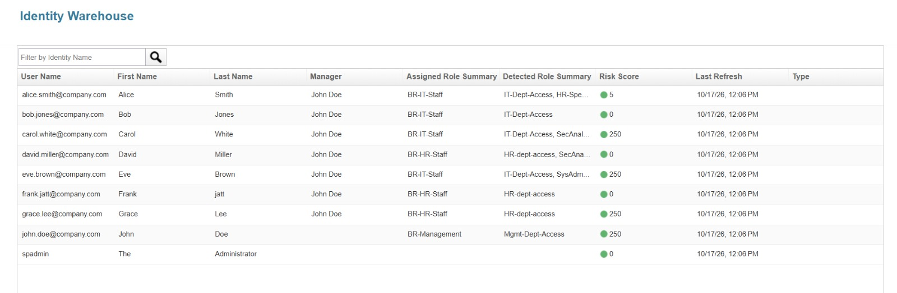 | 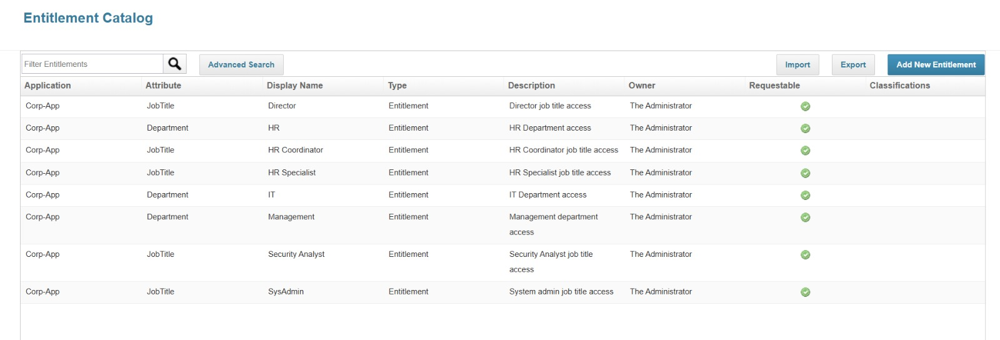 |

### Roles and lifecycle
| Role management | Lifecycle events |
|---|---|
| 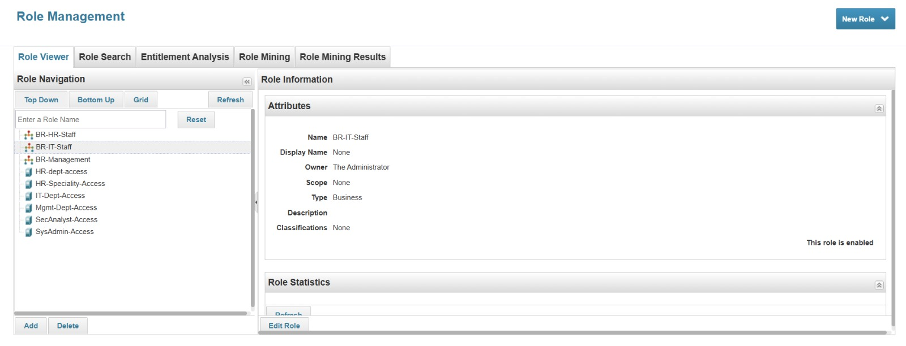 | 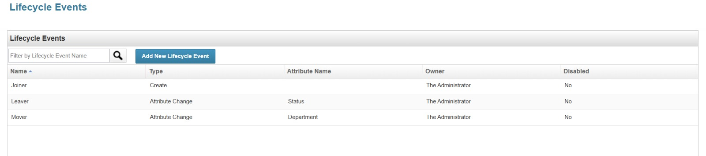 |

### Requests and work items
| Access requests (Bob's request and Alice's leaver request) | Manual work item |
|---|---|
| 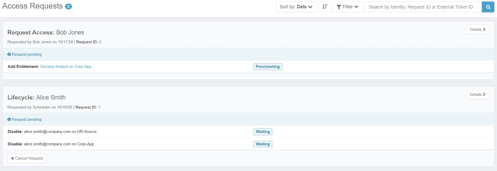 | 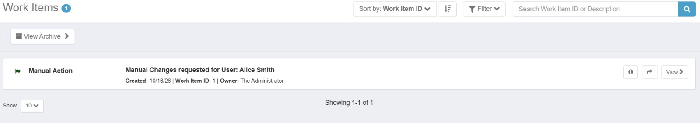 |

### Certification
| Results and decision statistics | Bob's certification history (revoke) |
|---|---|
| 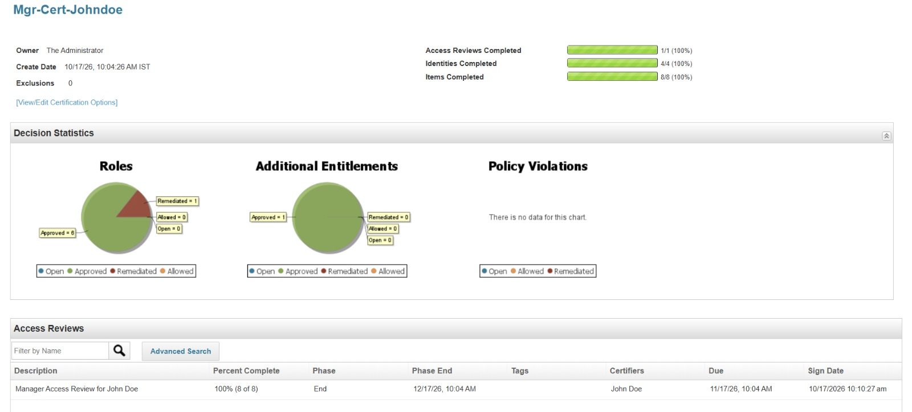 | 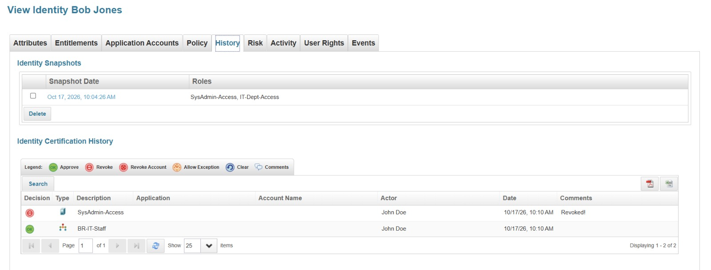 |

### Policy violation
| Separation-of-duties policy | Violation for Alice |
|---|---|
| 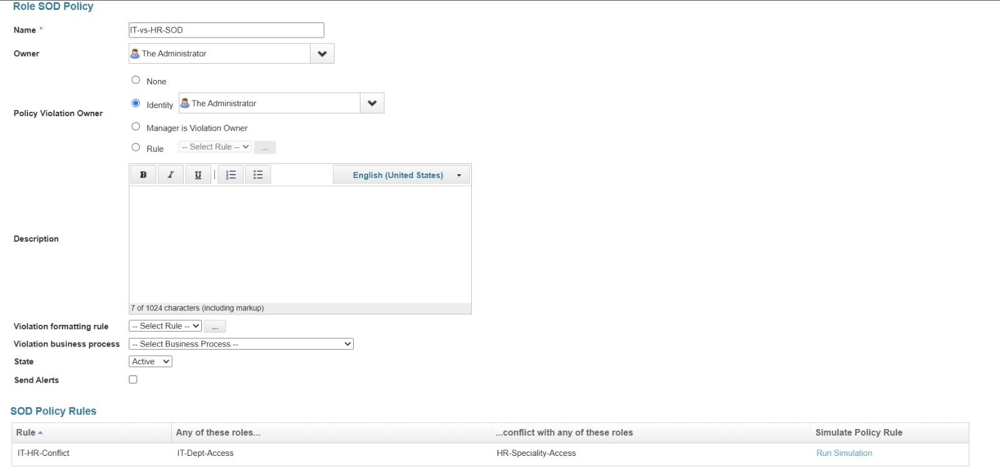 | 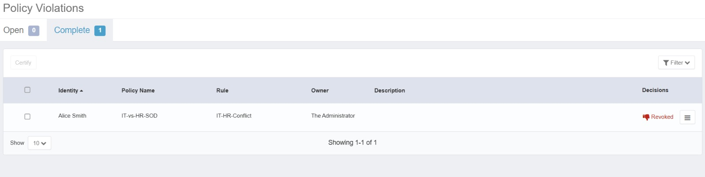 |

### Outlier analysis
| Alice as the outlier | Peer-group breakdown |
|---|---|
| 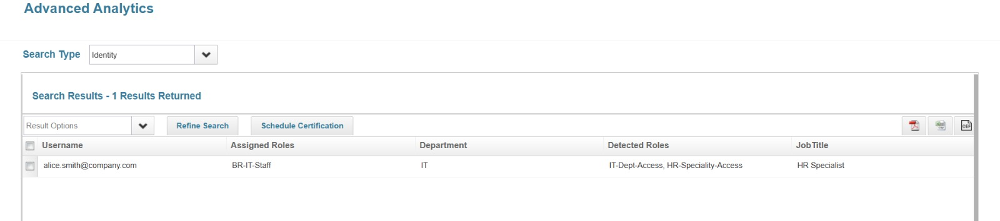 | 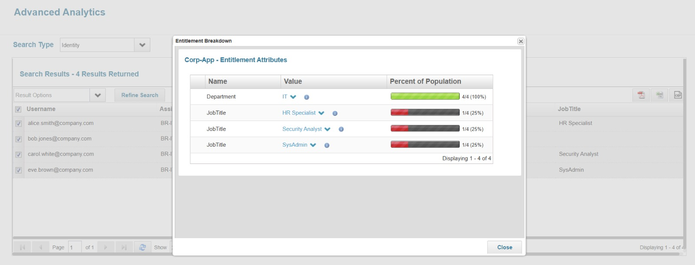 |

## 📂 Repository structure

```
IIQ-Governance-Project/
├── README.md
├── data/
│   ├── hr_source_data.baseline.txt   # starting HR feed (5 identities)
│   └── corp_app_data.txt             # final Corp-App feed after all tests (8 identities)
├── docs/
│   ├── lab-walkthrough.md            # configuration details, step by step
│   └── screenshots/                  # evidence for each stage
├── exports/                          # XML exports from the Object Browser
│   ├── Corp-App.xml
│   ├── IT-vs-HR-SOD.xml
│   └── lifecycle-events/             # Joiner, Mover, Leaver
├── .gitignore
└── LICENSE
```

## ▶️ How to reproduce

Full details are in [`docs/lab-walkthrough.md`](docs/lab-walkthrough.md). In short:

1. Install IdentityIQ 8.1 (JDK, Tomcat, MySQL) and import `init.xml` and `init-lcm.xml`.
2. Place the data files in `C:\SailPointData\`.
3. Create `HR-Source` (authoritative) and `Corp-App` (entitlements) as delimited-file applications.
4. Aggregate both, promote managed attributes, and set descriptions and owners in the Entitlement Catalog.
5. Create the IT roles, the Business roles and their assignment rules, then refresh identities.
6. Create the Joiner, Mover and Leaver lifecycle events.
7. Edit the data file and re-aggregate to drive each test case.

> IdentityIQ is licensed software. This repository contains only **configuration, sample data and evidence**, never SailPoint binaries. All people and data are fictional.

## 🧠 Key learnings and limitations

- **File-based applications are read-only.** Provisioning and revocation produce manual work items instead of changes on a target system. Remediation was completed by updating a separate copy of the file for `Corp-App`.
- **Attribute-change events fire only when a value changes**, so test data must be loaded in its starting state first.
- **Leaver handling is partial.** The Leaver workflow raises disable requests, but Alice keeps `BR-IT-Staff` because the assignment rules check only the department. Adding an `hrStatus` condition to the rules would drop roles for leavers.
- **No dedicated outlier task** is available in this 8.1 install, so outlier analysis used Advanced Analytics searches and the entitlement breakdown on a department peer group.
- **Small dataset.** With 9 identities the statistics are limited; the approach is what the lab demonstrates.

## 🚀 Possible next steps

- Connect a writable target (JDBC) to demonstrate automated provisioning and de-provisioning
- Add an `hrStatus` condition to role assignment rules so leavers lose their roles
- Add application owner and role composition certifications
- Add a custom approval step (for example, security approval for privileged roles)
- Schedule recurring aggregation and certification tasks

## 👤 Author

**Saksham Singh**
IAM and identity governance enthusiast

🔗 [LinkedIn](https://www.linkedin.com/in/saksham-singh-0832b0311) · 🐙 [GitHub](https://github.com/SakshamSingh13)

> ⭐ If this project helped you, consider giving it a star.
